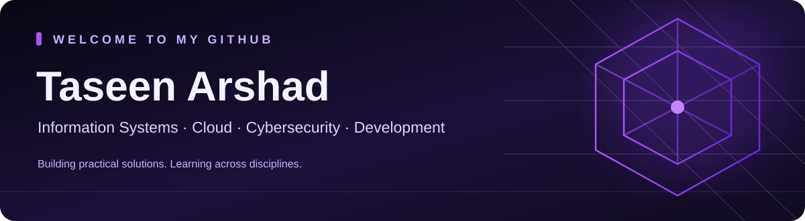

  

   

  

   

  
  
  

  
<strong>Open to internships and entry-level IT opportunities</strong>

---

## 👋 About Me

I'm an **Information Systems senior at the University of Texas at Arlington**, expecting to graduate in **Fall 2026**.

My interests span **cybersecurity, cloud computing, software development, networking, and IT infrastructure**. I enjoy understanding how these disciplines connect—and turning what I learn into practical projects.

MMy work includes an **AWS Security Monitoring Lab** for cloud audit logging, detection, and alerting; **DocTime**, a full-stack medical appointment management application; and a **Network Intrusion Detection Lab** using Wireshark and Suricata to investigate network protocols, analyze security alerts, and document findings.

I'm building a broad technical foundation through hands-on experimentation, documentation, and continuous learning. I'm interested in opportunities where I can contribute to real systems, solve meaningful problems, and keep growing across IT disciplines.

## 🚀 Featured Projects

<table>
<tr>
<td width="50%" valign="top">
<h3>☁️ AWS Security Monitoring Lab</h3>

Built an AWS monitoring workflow to collect audit events, detect selected authorization-related activity, and deliver email notifications.

<strong>Highlights</strong> CloudTrail audit logging · S3 audit archive · CloudWatch Logs metric filters and alarms · SNS notifications · Controlled validation and documented evidence

<code>AWS</code> <code>CloudTrail</code> <code>CloudWatch</code> <code>SNS</code> <code>IAM</code>

<a href="https://github.com/Taseenarshad/aws-security-monitoring-lab"><strong>Explore repository →</strong></a>
</td>
<td width="50%" valign="top">
<h3>🩺 DocTime — Appointment Platform</h3>

Developed a full-stack medical appointment application with dedicated patient, doctor, and administrator experiences.

<strong>Highlights</strong> Role-based dashboards · Doctor discovery · Appointment scheduling · Spring Boot APIs · H2 database

<code>Java</code> <code>Spring Boot</code> <code>React</code> <code>JavaScript</code> <code>H2</code>

<a href="https://github.com/Taseenarshad/Doctime-project"><strong>Explore repository →</strong></a>
</td>
</tr>
</table>

### 🔎 Network Intrusion Detection Lab — Wireshark & Suricata

Conducted a hands-on network security investigation using Wireshark and Suricata IDS to analyze network traffic, investigate detection alerts, and assess potential security events.

**Highlights**
- Completed four documented investigations covering DNS, TCP, TLS, and Suricata IDS.
- Analyzed TCP connection behavior, retransmissions, DNS resolution, and encrypted TLS communication.
- Investigated **49 Suricata alerts across three detection signatures**, correlating detections with packet-level evidence.
- Distinguished likely benign activity from potential security concerns; no confirmed intrusion was established.

`Wireshark` `Suricata IDS` `TCP/IP` `DNS` `TLS` `Packet Analysis` `Alert Triage`

[Explore repository →](https://github.com/Taseenarshad/network-intrusion-detection-lab)
  

## 🧰 Technologies I've Worked With

**Programming & development**

     

**Cloud, security & networking**

      

**Tools, systems & data**

      

## 🎓 Certifications & Credentials

**Professional certificates**
- Google IT Support Professional Certificate
- Google Cybersecurity Professional Certificate
- Microsoft / LinkedIn Career Essentials in Cybersecurity

**Technical badges**
- Cengage Excel Badge
- Cengage PowerPoint Badge

*Verification links can be added later.*

## 🌱 What I'm Building & Exploring

- **Network analysis:** Building practical knowledge of packet inspection, network protocols, and traffic analysis with Wireshark.
- **Cloud security:** Exploring ways to extend monitoring, detection, and alerting capabilities.
- **IT infrastructure:** Strengthening my understanding of operating systems, networking, and security operations.
- **Software development:** Continuing to develop programming, application architecture, and database skills.

## 📖 My Journey

<strong>How I got into technology and what I've learned along the way</strong>

 
My journey into technology has been shaped by my Information Systems education and an interest in how different systems work together.

Through <strong>DocTime</strong>, I've explored full-stack application development and database management. My <strong>AWS Security Monitoring Lab</strong> introduced me to cloud audit logging, security detection, and automated alerting. My <strong>Wireshark Network Traffic Analysis Lab</strong> is helping me develop a deeper understanding of network communication, packet inspection, and traffic analysis.

Each project has helped me translate technical concepts into practical experience while exploring different areas of IT.

## 🤝 Let's Connect

I'm based in **Dallas–Fort Worth, Texas** and open to **internships and entry-level IT opportunities**, including roles related to cybersecurity, cloud, software, and information systems.

📫 **Email:** [taseenarshad02@gmail.com](mailto:taseenarshad02@gmail.com)  
💼 **LinkedIn:** [Taseen Arshad](https://www.linkedin.com/in/taseen-arshad-b3b1b7269)  
💻 **GitHub:** [Taseenarshad](https://github.com/Taseenarshad)

  Thanks for visiting — always learning, always building.

